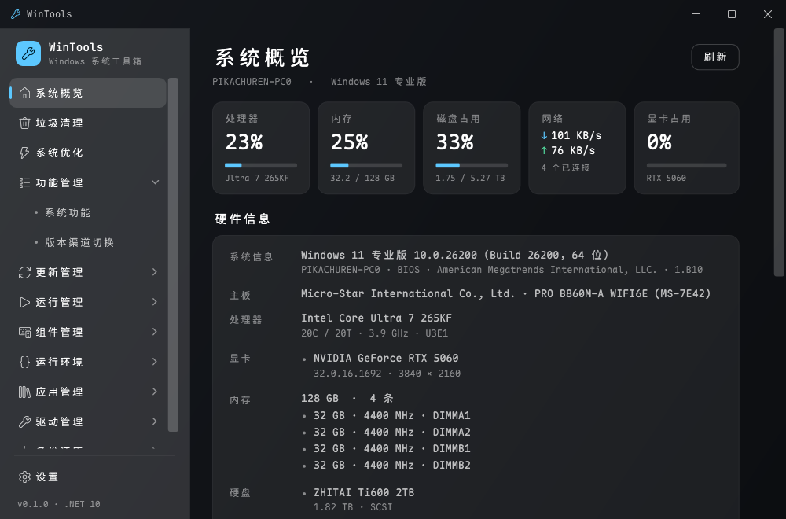

<div align="center">


# WinTools

Windows 上那些零散的维护操作，装进一个窗口里做完。

[](https://www.microsoft.com/windows)
[](https://dotnet.microsoft.com)
[](https://github.com/PIKACHUIM/WinTools/releases)
[](LICENSE)<br/>
[](https://pikachuim.github.io/WinTools/)
[](https://github.com/PIKACHUIM/WinTools/actions/workflows/build.yml)
[](https://github.com/PIKACHUIM/WinTools/actions/workflows/docs.yml)

</div>


## 这个工具是干什么的

装完系统之后要调的东西就那么些：清掉几十 GB 的缓存和更新残留、关掉一批不想要的遥测、把某个惹事的补丁卸了、看一眼开机到底加载了什么、给缺 VC++ 运行库的软件补一下、把老驱动导出备着、重装前打个镜像。这些事平时要在「设置」「控制面板」「磁盘清理」「设备管理器」和几篇博客之间来回跳，WinTools 把它们收进一个 WPF 程序里，统一的操作习惯，统一的日志。

十个模块：**垃圾清理、系统优化、功能管理、更新管理、运行管理、组件管理、运行环境、应用管理、驱动管理、备份还原**。

有几件事它**不做**，先说清楚：

- 不装服务、不注册驱动、不加开机自启，关掉窗口进程就没了。
- 没有「一键全家桶」。优化项是逐条勾选、逐条生效，每一条都能单独撤销。
- 不引第三方 UI 框架，控件模板全部手写，也没有花哨的动效。界面的目标是几秒钟内找到按钮。

## 功能

### 概览

进来先看到机器现在的状态：系统版本与内部版本号、CPU / 内存占用、每块磁盘的剩余空间，以及各模块的常用入口。数据在本地读，不联网。

### 垃圾清理

按磁盘扫描，19 个分类、约 480 条规则，覆盖系统临时目录、Windows 更新缓存、各类日志与转储、浏览器缓存、开发工具缓存（npm / pip / NuGet / Gradle / Docker 等）以及 150 多款常用软件的缓存目录。

- 结果按分类折叠，每项标出大小和安全等级，勾选后一次清完。
- 有进程占用的文件会跳过并记下来，不会因为一个 dll 卡住整轮清理。
- 规则是纯 JSON，放在 `src/WinTools.Infrastructure/Rules/`，想加自己的路径直接改文件，不用碰代码。

### 系统优化

51 条优化项，按用途分成 10 组：隐私与遥测、性能与响应、资源管理器、系统行为、网络、更新、游戏、任务栏、账户与安全、开机引导。

每条都有「检测 / 应用 / 回滚」三个动作，先跑一次检测看当前是什么状态，再决定要不要动——不是点了就写注册表完事。顶部有「推荐项」和「全选」，但推荐项只包含社区里长期验证过、副作用小的那些。

### 功能管理

两个页签，都在跟 Windows 的版本与组件打交道：

- **系统功能**：通过 DISM API 列出全部可选功能（一百多项，随系统版本浮动），按用途分组，带中文说明和当前状态。改完统一「应用」，可以指定离线源。
- **版本渠道切换**：读出当前 SKU、版本号和激活状态；需要换版本时走系统自带的 `changepk` 向导，操作前先备份产品密钥。这一步有激活风险，界面会明说。

### 更新管理

- **已安装更新**：走 WUA 会话读历史记录，按 KB 号搜，选中后卸载。
- **可安装补丁**：在线扫描可用更新（含驱动更新），勾选下载安装，不需要的可以隐藏。
- **功能开关**：`FeatureManagement\Overrides` 的读写，支持 0/1/未设置三态和自定义特性 ID，输入 ID 会自动算哈希。ViVeTool 能做的这里都能做，改完需重启生效。

### 运行管理

开机到底起了什么，是很多「开机变慢」的真正答案。三个页签：

- **启动项**：Run / RunOnce / 启动文件夹，启用状态跟任务管理器写的是同一处（StartupApproved），两边显示一致。
- **计划任务**：递归枚举全部任务，可启停、立即运行、删除。
- **服务管理**：查看状态并调整启动类型。这里刻意不做「一键禁用服务列表」——服务之间的依赖关系太容易被忽略，改了以后蓝屏或更新失败很难查。

### 组件管理

- **安全中心**：Defender 的实时保护、行为监控、篡改保护状态，以及排除项的增删。
- **应用商店**：Microsoft Store 相关组件的健康检查、缓存重置、重新注册，用于对付「商店打不开」。

### 运行环境

- **.NET**：按主版本列出 Desktop / Runtime / ASP.NET Core 的 x64 与 x86 安装情况。
- **VC++**：枚举 2005 到 2022 的各版本运行库，支持静默卸载——重新装一遍运行库合集之前，先把旧的清掉。

### 应用管理

- **已安装程序**：读注册表 Uninstall 键（含 WOW6432Node 和当前用户），显示发布者、版本、占用空间；卸载优先走程序自带的静默参数，失败再交给它自己的卸载程序。
- **Appx**：列出 UWP / MSIX 应用并移除。

### 驱动管理

围绕 DriverStore 的完整流程：枚举包列表与已加载驱动（名称、提供者、类别、版本、日期、签名）、批量导出、从目录或 inf 安装、按发布名删除并卸载。删除前会强制先导出一份备份，再二次确认，返回码写进日志。

### 备份还原

调用 WIMGAPI，可以做四件事：

- **系统备份**：把分区捕获成 wim / esd / swm，可设映像名称、描述和压缩级别。
- **增量备份**：向已有映像追加索引，省掉重复的全量捕获。
- **WIM 信息**：查看映像内的索引与属性。
- **释放镜像**：把 wim / esd / swm 展开到指定目录。

捕获和释放都走系统 API，不是自己拼文件格式，所以生成的镜像能用 DISM 和 Windows 安装程序正常读取。

<details>
<summary>更多截图</summary>

| 垃圾清理 | 系统优化 |
| :---: | :---: |
|  |  |

| 功能管理 | 更新管理 |
| :---: | :---: |
|  |  |

| 运行管理 | 组件管理 |
| :---: | :---: |
|  |  |

| 运行环境 | 应用管理 |
| :---: | :---: |
|  |  |

| 驱动管理 | 备份还原 |
| :---: | :---: |
|  |  |

深色主题：



</details>

## 界面语言

界面文案全部来自语言包，代码里没有硬编码的中文或英文。

| 语言 | 代码 | 说明 |
| --- | --- | --- |
| 简体中文 | `zh-Hans` | 默认 |
| 繁體中文 | `zh-Hant` | |
| English | `en-US` | 兜底语言 |
| 日本語 | `ja-JP` | |
| 한국어 | `ko-KR` | |
| Deutsch | `de-DE` | |
| Français | `fr-FR` | |
| Español | `es-ES` | |
| Português | `pt-BR` | |
| Italiano | `it-IT` | |
| Русский | `ru-RU` | |
| العربية | `ar-SA` | 从右到左布局 |

几个实现上的细节：

- 首次启动跟随系统语言：`zh-CN` / `zh-SG` 走简体，`zh-TW` / `zh-HK` / `zh-MO` 走繁体，`pt-PT` 这类没有精确匹配的按语言父级归到最近的变体，认不出来的回落到 `en-US`。
- 切换语言即时生效，不用重启：所有文本走同一个 `Loc` 绑定源，切换时统一通知刷新。
- 语言包是按需加载的，启动时只解析当前语言和兜底语言两份 JSON，不是一次性读 12 个文件。
- 阿拉伯语会切换整体阅读方向（RTL），不只是换字符串。

新增一门语言只需要在 `src/WinTools.App/Assets/i18n/` 下加一个 JSON，并在 `LocalizationService.AvailableLanguages` 里注册一行。缺少的键会自动回落到英文。

## 下载与安装

| 版本 | 体积 | 适合 | 下载 |
| --- | --- | --- | --- |
| 便携单文件 | 约 70 MB | 自带 .NET 运行时，解压即用；放 U 盘、PE 环境都行 | [WinTools-*-portable-win-x64.exe](https://github.com/PIKACHUIM/WinTools/releases/latest) |
| 框架依赖版 | 约 22 MB | 体积小，机器上已有 .NET 10 就能跑 | [WinTools-*-framework-win-x64.zip](https://github.com/PIKACHUIM/WinTools/releases/latest) |
| Beta 预发布 | 同上 | 每次推送到 `main` 自动重建，可用来提前试新功能 | [releases/tag/beta](https://github.com/PIKACHUIM/WinTools/releases/tag/beta) |

- 正式版带 **Certum 云签名 + 时间戳**，可用 `Get-AuthenticodeSignature` 校验；`SHA256SUMS.txt` 与安装包一起发。
- 程序以**管理员权限**运行（清单里已声明），因为 DISM、驱动、服务、WIM 这些操作没有管理员权限做不了。
- 目前只提供 `win-x64`，`arm64` 的构建参数已经预留。
- 校验值和更新日志在 [Releases](https://github.com/PIKACHUIM/WinTools/releases) 里，跟着每个版本一起发。

## 系统要求

- Windows 10 1809（17763）及以上，或 Windows 11，x64
- 框架依赖版需要 [.NET 10 Desktop Runtime](https://dotnet.microsoft.com/download/dotnet/10.0)
- 部分功能会调用系统组件：DISM（功能管理）、WUA（更新管理）、`pnputil`（驱动管理）、WIMGAPI（备份还原）。这些是 Windows 自带的，精简版系统上可能被删掉

## 实现上的几个决定

| 方面 | 做法 |
| --- | --- |
| UI | WPF + CommunityToolkit.Mvvm，`net10.0-windows`。控件模板全部手写，不用第三方 UI 框架 |
| 依赖 | 4 个 NuGet 包：CommunityToolkit.Mvvm、Microsoft.Extensions.DependencyInjection、LiveChartsCore.SkiaSharpView.WPF；其余控件模板全部手写 |
| 系统调用 | 一律 P/Invoke、COM 后期绑定（WUA / 计划任务 / WMI）和注册表；不引 WinRT 投影，也不用 `System.Management` |
| 长列表 | `ListBox` + 虚拟化回收，三百多个服务、一百多个驱动滚动不掉帧 |
| 菜单 | 数据驱动：`Rules/modules.json` 定义一级/二级菜单和 12 种语言的标题，加模块不用改外壳代码 |
| 审计 | 破坏性操作写 JSONL 审计日志，运行日志同目录，都在 `%ProgramData%\WinTools\logs` |
| 启动 | `WINTOOLS_TRACE=1` 开启启动打点；热启动约 0.7 s，其中 WPF 首次建窗占 0.37 s 左右 |

## 从源码构建

需要 .NET 10 SDK。

```powershell
# 调试构建
dotnet build src/WinTools.App/WinTools.App.csproj

# Release 构建
dotnet build src/WinTools.App/WinTools.App.csproj -c Release

# 生成两种发行包 → artifacts/publish/{portable,framework}
powershell -ExecutionPolicy Bypass -File tools/publish.ps1 -Profile both
```

架构说明、模块实现、规则格式、本地化与调试技巧写在文档站里：**[在线文档](https://pikachuim.github.io/WinTools/)** 或 [docs/guide/development.md](docs/guide/development.md)。

## 参考与致谢

这个工具的大部分设计判断不是原创，而是从这些项目里学来的——它们已经把「优化项该怎么分类」「哪些注册表项不能碰」这类问题用几年时间试错了一遍，直接借鉴比自己踩坑划算得多：

| 项目 | 用到了什么 |
| --- | --- |
| [winutil](https://github.com/ChrisTitusTech/winutil)（Chris Titus Tech） | 优化项的分组方式、先选后应用的交互节奏 |
| [Optimizer](https://github.com/hellzerg/optimizer)（hellzerg） | 优化条目划分、风险提示的措辞、启动项与服务的组织 |
| [ZyperWinOptimize](https://github.com/ZyperRap/ZyperWinOptimize)（ZyperRap） | 中文环境下的优化项清单与界面信息密度 |
| [Dism-Multi-language](https://github.com/Chuyu-Team/Dism-Multi-language)（Chuyu-Team） | DISM 用法与多语言资源的组织 |
| [geek-uninstaller](https://geekuninstaller.com/)（Geek Uninstaller） | 已安装程序列表的字段取舍与卸载交互 |
| [ViVeTool](https://github.com/thebookisclosed/ViVe)（thebookisclosed） | 特性开关的数据结构、三态语义与 ID 哈希 |

相比之下，差别主要在三处：界面做成 12 种语言、优化项逐条可回滚、服务只提供状态与启动类型而不批量停用。这些选择多半也是从上面几家的 issue 和讨论里挑出来的，谈不上原创。

清理规则最初来自 `F盘缓存垃圾清理清单.csv` 里的一百多条路径，之后按系统缓存、浏览器缓存、开发工具缓存陆续补齐，现在由 `tools/rules/*.txt` 维护、`tools/Generate-CleanupRules.ps1` 生成。种子清单留在 `tools/rules/legacy/` 下，只作历史记录。

## 免责声明

- 工具会改注册表、服务启动类型、系统功能和驱动。动手前请**创建还原点或备份重要数据**。
- 因使用本工具造成的数据丢失或系统损坏，作者不承担责任。
- 请勿用于绕过软件许可、激活或其他违反当地法律法规的用途。

## 许可证

[AGPL-3.0](LICENSE) © WinTools
