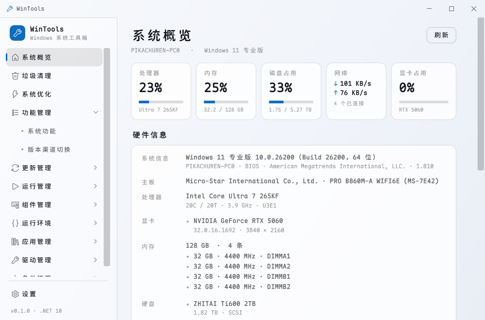
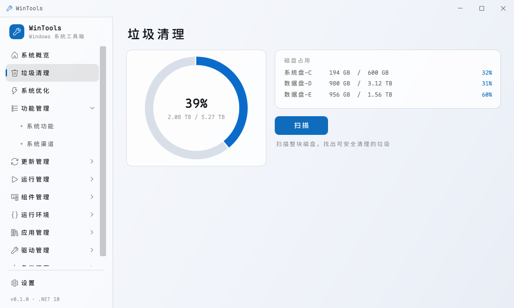
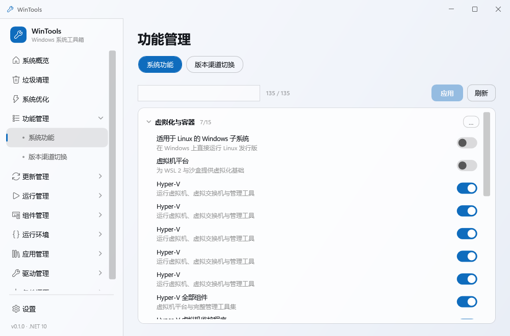
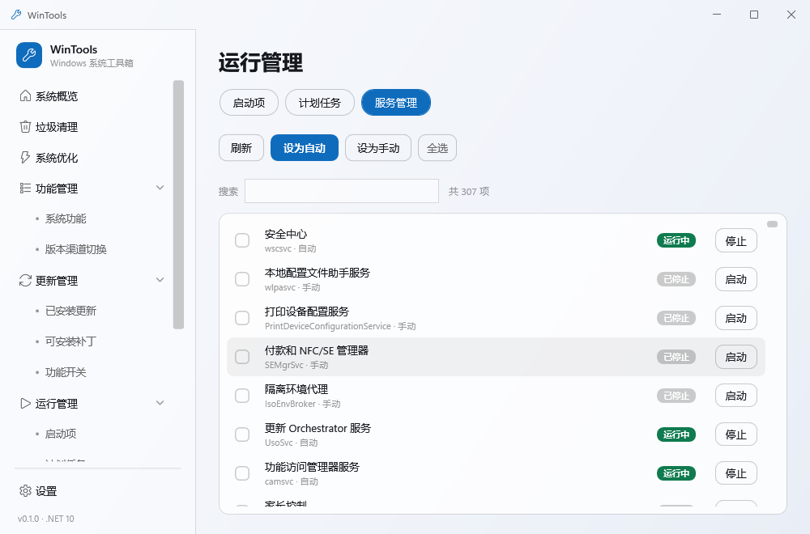
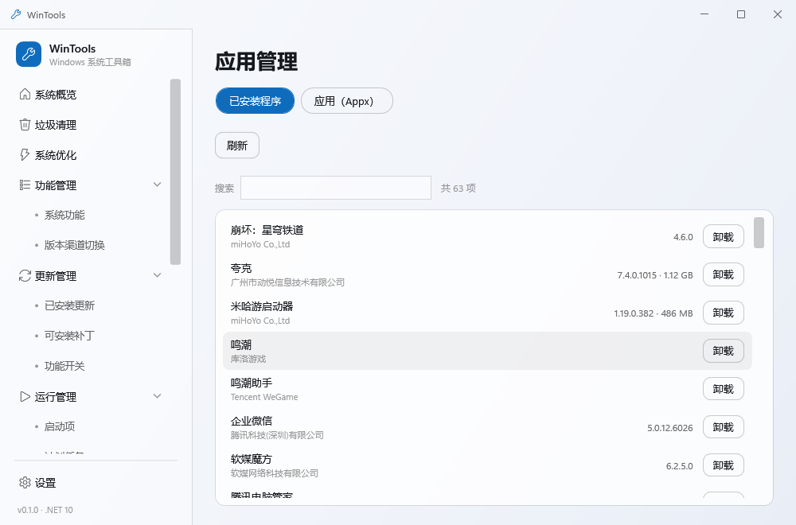
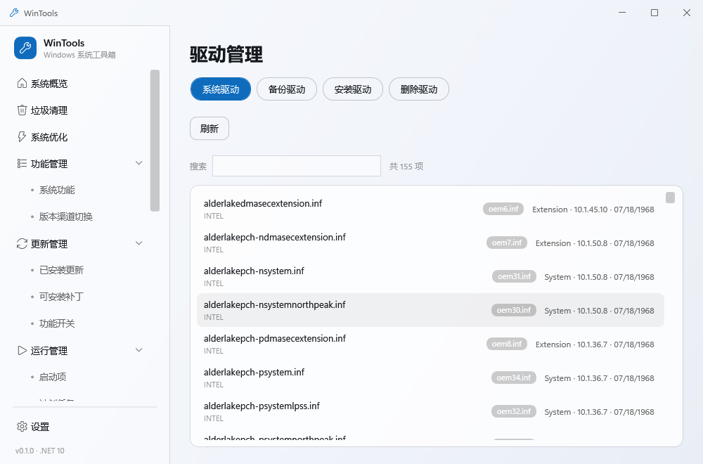
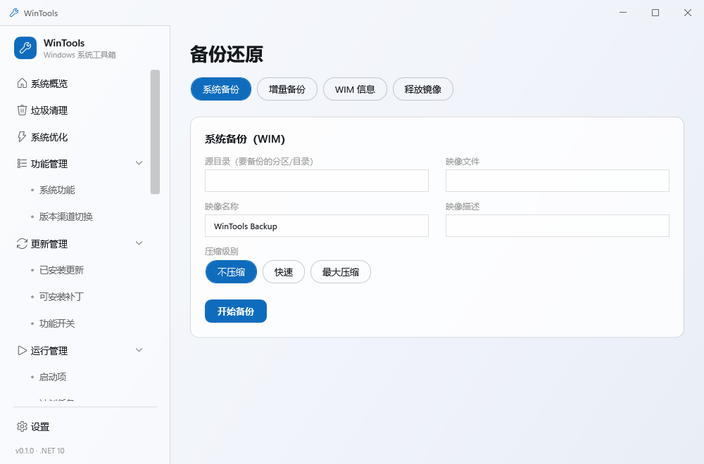

<p align="center">
  <a href="README.md">English</a> · <a href="README.zh-CN.md">简体中文</a> · <b>繁體中文</b><br/>
  <sub>Windows 系統工具箱 · 清理 / 優化 / 元件 / 驅動 / 備份</sub>
</p>

<p align="center">
  
</p>

<h1 align="center">WinTools</h1>

<p align="center">
  <a href="https://github.com/PIKACHUIM/WinTools/releases"></a>
  <a href="https://www.microsoft.com/windows"></a>
  <a href="https://dotnet.microsoft.com"></a>
  <a href="LICENSE"></a>
  <a href="https://github.com/PIKACHUIM/WinTools/actions/workflows/build.yml"></a>
  <a href="https://wtools.opkg.cn/"></a>
</p>

## 簡介

WinTools 把常見的系統維護工作集中到一個視窗：清理快取與更新殘留、關閉不需要的遙測、移除有問題的更新、查看開機載入了哪些項目、補裝執行環境、匯出舊驅動、重裝系統前建立映像。

WPF 桌面程式，完全在本機執行。不裝服務、不載入驅動、不加入開機啟動、不連網，關閉視窗後行程即結束。

十個模組：**垃圾清理、系統優化、功能管理、更新管理、執行管理、元件管理、執行環境、應用管理、驅動管理、備份還原**。

## 系統需求

- Windows 10 1809（17763）以上，或 Windows 11，x64
- 框架相依版需要 [.NET 10 Desktop Runtime](https://dotnet.microsoft.com/download/dotnet/10.0)
- 需要系統管理員權限（資訊清單已宣告），DISM、驅動、服務、映像操作都依賴它
- 部分功能會呼叫系統內建元件：DISM、Windows Update Agent、`pnputil`、WIMGAPI。精簡版系統可能已移除

## 下載

| 版本 | 大小 | 說明 | 下載 |
| --- | --- | --- | --- |
| 免安裝版 | 約 70 MB | 自帶執行環境，解壓即用 | [WinTools-*-portable-win-x64.exe](https://github.com/PIKACHUIM/WinTools/releases/latest) |
| 框架相依版 | 約 22 MB | 需要 .NET 10 Desktop Runtime | [WinTools-*-framework-win-x64.zip](https://github.com/PIKACHUIM/WinTools/releases/latest) |
| Beta | 同上 | 每次推送到 `main` 自動重建 | [releases/tag/beta](https://github.com/PIKACHUIM/WinTools/releases/tag/beta) |

正式版具備 Certum 雲端簽章與時間戳，可用 `Get-AuthenticodeSignature` 驗證。每個版本附帶 `SHA256SUMS.txt`。

## 功能

### 系統概覽

系統版本與組建編號、CPU 與記憶體使用率、各磁碟剩餘空間、近期活動。資料全部在本機讀取。



### 垃圾清理

依磁碟掃描，23 個分類、1623 條規則，涵蓋系統暫存目錄、更新快取、記錄與傾印、瀏覽器快取、開發工具快取（npm、pip、NuGet、Gradle、Docker），以及 150 多款軟體的快取目錄。

結果依分類收合，標示大小與安全等級。被行程占用的檔案會略過並記錄，不會卡住整輪清理。規則是純 JSON，放在 `src/WinTools.Infrastructure/Rules/`，新增路徑不需要改程式碼。



### 系統優化

153 條優化項目，分為 7 組：隱私與遙測、效能與反應、檔案總管、系統行為、網路、更新、遊戲。

每條都支援偵測、套用、還原，修改前可以先看目前狀態。推薦項目只包含副作用明確的條目。


### 功能管理

- **系統功能**：透過 DISM API 列出全部選用功能，依用途分組，附說明與目前狀態，修改後批次套用。
- **系統通道**：讀取目前 SKU、版本與啟用狀態。切換版本使用系統內建的 `changepk` 與內建通用金鑰，不會啟用系統。



### 更新管理

- **已安裝更新**：列舉並移除單筆更新。
- **可安裝更新**：手動觸發 Windows Update 搜尋，顯示分類、KB、大小與日期，支援批次安裝並提供結果摘要。
- **功能開關**：依 ID 管理 `FeatureManagement\Overrides`，包含狀態、優先順序、變體，支援匯入、匯出與重設。


### 執行管理

啟動項目、排程工作、服務集中在一頁。顯示程式實際圖示，啟用狀態以開關控制。服務可在列內切換啟動類型（自動、延遲自動、手動、停用）。



### 元件管理

- **安全中心**：14 項設定，包含即時保護、雲端保護、行為監控、PUA、網路保護、受控資料夾、記憶體完整性、UAC、SmartScreen、三個防火牆設定檔，以及排除項目。
- **系統元件**：內建應用程式（終端機、計算機、記事本、小畫家、相片等）的安裝、修復與移除；WSL 發行版；Android 子系統本機套件安裝；Microsoft Store 修復。


### 執行環境

列出已安裝的 .NET 與 Visual C++ 執行環境。可安裝版本依需求取得：.NET 讀取官方 `releases-index.json` 並驗證 SHA512，VC++ 使用 `aka.ms` 連結並驗證 Authenticode。兩者皆為靜默安裝，也能解除安裝。


### 應用管理

已安裝程式與應用程式套件，顯示圖示、版本、占用空間、安裝日期與最近使用。移除時呼叫軟體自帶的移除程式，應用程式套件則走部署介面。



### 驅動管理

整頁管理 DriverStore。勾選任意數量的驅動套件後備份、刪除，或從資料夾安裝。批次操作有逐項進度與結果摘要。



### 備份還原

WIM 擷取與釋放。來源磁碟區以下拉選擇，映像格式（wim / esd / swm）連動副檔名與壓縮方式，分割大小僅對 swm 生效，擷取前會列出預設排除項目。釋放時可驗證映像，並以 `bcdboot` 修復開機。



## 開發建置

需要 .NET 10 SDK。

```powershell
# 偵錯建置
dotnet build src/WinTools.App/WinTools.App.csproj

# Release 建置
dotnet build src/WinTools.App/WinTools.App.csproj -c Release

# 產生兩種發行包 → artifacts/publish/{portable,framework}
powershell -ExecutionPolicy Bypass -File tools/publish.ps1 -Profile both
```

架構說明、模組實作、規則格式、在地化與偵錯技巧見 **[wtools.opkg.cn](https://wtools.opkg.cn/)** 或 [docs/guide/development.md](docs/guide/development.md)。

## 參考專案

| 專案 | 借鏡內容 |
| --- | --- |
| [winutil](https://github.com/ChrisTitusTech/winutil) | 優化項目分組、先選後套用的互動 |
| [Optimizer](https://github.com/hellzerg/optimizer) | 優化分類、風險提示措辭、啟動項與服務組織 |
| [ZyperWinOptimize](https://github.com/ZyperRap/ZyperWinOptimize) | 中文環境的優化清單與資訊密度 |
| [Dism-Multi-language](https://github.com/Chuyu-Team/Dism-Multi-language) | DISM 用法與多語系資源組織 |
| [Geek Uninstaller](https://geekuninstaller.com/) | 已安裝程式清單的欄位取捨 |
| [ViVeTool](https://github.com/thebookisclosed/ViVe) | 功能開關的資料結構與三態語意 |

清理規則最初來自一份個人整理的快取路徑清單，之後陸續補齊。目前由 `tools/rules/*.txt` 維護，`tools/Generate-CleanupRules.ps1` 產生。

## 免責聲明

- 本工具會修改登錄、服務啟動類型、系統功能與驅動。使用前請建立還原點或備份重要資料。
- 因使用本工具造成的資料遺失或系統損壞，作者不負任何責任。
- 請勿用於規避軟體授權、啟用或其他違反當地法令的用途。

## 開源授權

[AGPL-3.0](LICENSE) © WinTools

### 第三方元件

| 元件 | 授權 | 用途 |
| --- | --- | --- |
| [Maple Mono NF CN](https://github.com/subframe7536/maple-font) | SIL OFL 1.1 | 介面字型，以 TTF 內嵌 |
| [CommunityToolkit.Mvvm](https://github.com/CommunityToolkit/dotnet) 8.4.2 | MIT | MVVM 來源產生器 |
| [Microsoft.Extensions.DependencyInjection](https://github.com/dotnet/runtime) 10.0.13 | MIT | 相依性注入 |
| [VitePress](https://vitepress.dev/) | MIT | 僅用於文件站 |

內嵌字型依 OFL-1.1 再散布：可自由使用、修改與再散布，但不得單獨販售字型本身；修改後的版本不得繼續使用保留字型名稱；再散布時需附上本聲明。上游提供的是 WOFF2，WPF 僅支援 TrueType/OpenType，因此以 `tools/Convert-Woff2ToTtf.py` 轉為 TTF 後內嵌，字形輪廓未作更動。

`Segoe Fluent Icons` / `Segoe MDL2 Assets` 為 Windows 系統內建字型，不隨本程式散布。
